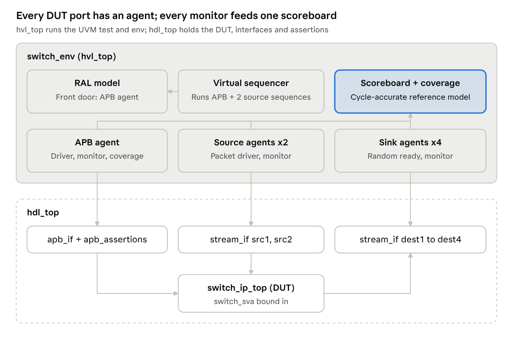

# Switch IP: a 2-source, 4-destination packet switch, from specification to verified RTL

The Switch IP routes packets from 2 source ports to 4 destination ports over valid/ready streams. Each packet's
header carries a 12-bit destination address. The address is decoded against 4 programmable ranges, then checked
against a fixed hardware permission matrix and a software route-enable register. Packets that break a rule are
dropped and flagged on a single sticky `error` pin. dest3 and dest4 are shared and use packet-level round-robin
arbitration, and an APB4 slave holds the configuration, status and counters.

The RTL is Verilog. It is verified with a Questa UVM testbench built around a cycle-accurate reference model:
**25 of 25 regression runs pass, with 100% DUT code coverage and 100% functional coverage.**

Start with the [specification](spec/Switch%20IP%20Specification.pdf), then the
[verification specification](dv/doc/switch_verification_spec.md), the
[testbench description](dv/doc/switch_testbench.md) and the [run guide](dv/sim/README.md).

---

## 1. Design at a glance

| Area | Implementation |
|---|---|
| Ports | 2 sources, 4 destinations; 32-bit data, `valid` / `ready` / `last`; header beat forwarded unchanged with the payload |
| Packet | Header `{src_id[31:28], dest_id[27:16], payload_size[15:8], rsvd[7:0]}`, then `payload_size` data beats |
| Decode | 4 programmable ranges (DESTn_BASE/LIMIT); lowest destination wins on overlap; BASE > LIMIT disables a range |
| Permission | Fixed matrix: src1 → dest1/3/4, src2 → dest2/3/4; ANDed with ROUTE_CFG |
| Header checks | LEN, SRCID, UNMAPPED, ILLEGAL, DISABLED, in that priority; first failure recorded; dropped packets fully consumed |
| Framing | Early `last` truncates the packet; late `last` is forced at `payload_size` and extra beats are discarded |
| Arbitration | Packet-level round-robin on dest3/dest4, src1 first after reset, no interleaving |
| Performance | 1 beat per clock per port, 1 clock from header acceptance to `destN_valid` |
| CSRs | APB4, zero wait states, 19 registers: CTRL, ROUTE_CFG, MAX_PAYLOAD, 8 range registers, W1C ERR_STATUS, ERR_MASK, ERR_HDR ×2, PKT_CNT ×2, DROP_CNT, ID_VERSION |
| Reset | Asynchronous assert, synchronous release (2-flop synchronizer) |

| RTL file | Contents |
|---|---|
| [`rtl/switch_ip_top.v`](rtl/switch_ip_top.v) | Top level: connects the blocks, holds the permission matrix and the crossbar |
| [`rtl/switch_ingress.v`](rtl/switch_ingress.v) | Per source: header decode and checks, framing, drops, one register stage |
| [`rtl/switch_rr_arb.v`](rtl/switch_rr_arb.v) | Packet-level round-robin arbiter |
| [`rtl/switch_csr.v`](rtl/switch_csr.v) | APB4 slave, CSRs, `error` pin, counters |
| [`rtl/switch_rst_sync.v`](rtl/switch_rst_sync.v) | Reset synchronizer |

## 2. Verification



| Part | What it is |
|---|---|
| APB VIP | Master agent (driver, monitor, coverage), `uvm_reg_adapter`, APB4 protocol assertions |
| Stream VIP | Source agent driving packets, sink agent with random `ready`, monitor, handshake assertions; packet kinds (`pkt_kind_e`) constrained against the live configuration |
| RAL | All 19 CSRs; status and counters volatile; explicit predictor |
| Scoreboard | Cycle-accurate reference model: every packet, every CSR read and `pslverr`, and the `error` pin on every clock |
| Coverage | src × dest × outcome, payload sizes, error bits set/cleared/collision, arbitration order, configuration corners, APB |
| Tests | 19 tests, 47 scenarios ([test plan CSV](dv/doc/switch_test_plan.csv)), 25-run regression |

Latest results ([`dv/results/`](dv/results/)):

| Metric | Result |
|---|---|
| Regression | 25 / 25 passed |
| DUT code coverage | 100%: statements 312/312, branches 217/217, conditions 32/32, expressions 66/66, FSM 6/6 states and 10/10 transitions |
| Functional coverage | 190 / 190 covergroup bins |
| Assertions | 39 / 39 passing, no failures; 24 / 24 cover properties hit |

Verification found one RTL bug (dest3/dest4 data changing while stalled); it is fixed. Remaining sign-off items and
spec interpretations are listed in the [verification specification](dv/doc/switch_verification_spec.md).

## 3. Running it

Requires Questa (tested on 2021.2_1 with its built-in UVM 1.1d).

```sh
cd dv/sim
make build                                  # compile once into the shared build
make sim test=switch_base_test              # one test (waveforms off by default)
make sim test=switch_arbitration_test wave=1
make regress                                # full regression from the same build
make cov                                    # merged coverage report
```

All commands and options: [`dv/sim/README.md`](dv/sim/README.md).

## 4. Repository layout

```
Switch_IP
├─ spec/                      Switch IP specification (PDF)
├─ rtl/                       Verilog RTL
└─ dv/
   ├─ vip/apb_vip/src/        APB master VIP
   ├─ vip/stream_vip/src/     packet stream VIP
   ├─ ral/                    register model
   ├─ env/                    scoreboard, coverage, env, virtual sequencer
   ├─ seq/                    virtual sequences
   ├─ test/                   tests
   ├─ top/                    hdl_top, hvl_top, DUT assertions
   ├─ sim/                    makefile, file lists, regression list, coverage exclusions, run guide
   ├─ doc/                    verification spec, testbench description, test plan CSV
   └─ results/                regression report and coverage summary of the latest run
```
