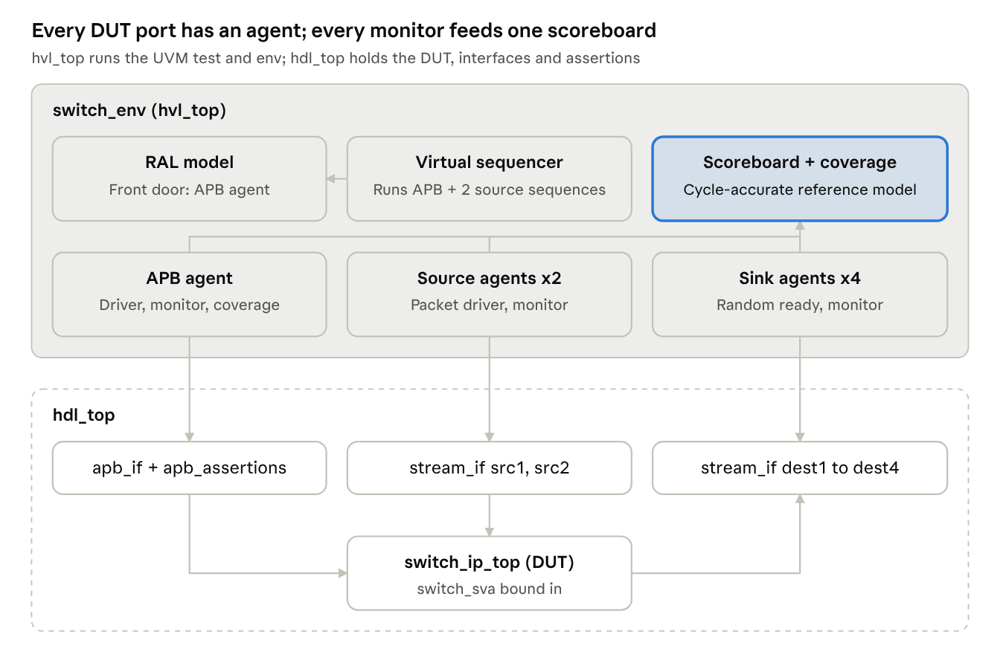

# Switch IP UVM Testbench

Nov 22, 2026 · Vijay Bogati

## Overview

The Switch IP is verified with a Questa UVM testbench (UVM 1.1d) built around a cycle-accurate reference model. A self-checking scoreboard checks every packet, every APB read, and the `error` pin on every clock. The testbench has 19 tests in a 25-run regression. Verification found one RTL bug in the dest3/dest4 arbiter, now fixed. On the fixed RTL all 25 runs pass, with 100% DUT code coverage and 100% functional coverage.

**Design under test.** `switch_ip_top` (Verilog, `rtl/`) routes packets from 2 sources to 4 destinations over valid/ready streams. Each route must pass a fixed hardware permission matrix and the software ROUTE\_CFG register. dest3 and dest4 are shared and use packet-level round-robin arbitration. An APB4 slave holds configuration, sticky error status and counters. The spec is `spec/Switch IP Specification.pdf`.

**Strategy.**

- **Reference model first:** the scoreboard re-implements the header checks, framing, CSRs and error logic, and predicts each outcome cycle by cycle.
- **Directed tests** cover each scenario in spec section 9.3. **Constrained-random tests** randomise configuration, packet defects, valid gaps and back-pressure.
- **Assertions** check the valid/ready and APB protocol rules on both sides of the DUT. Any assertion failure is reported as a `uvm_error`, so it fails the test.
- **Closure:** functional covergroups plus RTL code coverage, merged across the regression. Exclusions are allowed only for items that are unreachable by design, each with a written reason.

**Scope.** In scope: all ports, all 19 CSRs, every header check and drop path, early and late `last`, arbitration, back-pressure, dynamic configuration, SWITCH\_EN, and reset mid-packet. Out of scope: gate-level simulation and formal checks.

## Architecture

The APB, source and sink agents drive or watch every DUT port through their interfaces. The APB, source and destination monitors feed the scoreboard through analysis FIFOs, and the scoreboard also reads the `error` pin and reset through `switch_ctrl_if`. Sequences reach the APB bus through the RAL model and the APB agent's sequencer.

## Directory structure

The RTL lives in `rtl/`, the specification in `spec/`, and the whole UVM environment under `dv/`. It is split the same way as the reference APB VIP: VIP, RAL, env, sequences, tests, tops and sim.

| Path | Contents |
| --- | --- |
| `rtl/` | `switch_ip_top.v`, `switch_ingress.v`, `switch_rr_arb.v`, `switch_csr.v`, `switch_rst_sync.v` |
| `spec/` | `Switch IP Specification.pdf` |
| `dv/vip/apb_vip/src/` | `apb_global_pkg`, `apb_if`, `apb_assertions`, `apb_master_tx`, `_agent_config`, `_sequencer`, `_driver`, `_monitor`, `_coverage`, `_agent`, `_adapter`, `_seqs`, `apb_master_pkg` |
| `dv/vip/stream_vip/src/` | `stream_if`, `stream_tx`, `stream_beat`, `stream_agent_config`, `stream_sequencer`, `stream_src_driver`, `stream_sink_driver`, `stream_monitor`, `stream_agent`, `stream_seqs`, `stream_pkg` |
| `dv/ral/` | `switch_reg_block.sv` (register classes + block), `switch_ral_pkg.sv` |
| `dv/env/` | `switch_ctrl_if`, `switch_env_types`, `switch_env_config`, `switch_coverage`, `switch_scoreboard`, `switch_virtual_sequencer`, `switch_env`, `switch_env_pkg` |
| `dv/seq/` | `switch_base_vseq`, `switch_reg_vseqs`, `switch_traffic_vseqs`, `switch_system_vseqs`, `switch_vseq_pkg` |
| `dv/test/` | `switch_base_test`, `switch_tests` (test library), `switch_test_pkg` |
| `dv/top/` | `hdl_top.sv`, `hvl_top.sv`, `switch_sva.sv` (DUT assertions, bound from `hdl_top`) |
| `dv/sim/` | `makefile`, `switch_rtl.f`, `switch_tb.f`, `cov_exclusions.do`, `testlists/switch_regression.list` |

Every file starts with the project header block: project name, file name, module/class name, author, description.

## APB VIP

The APB master VIP drives APB4 transfers (12-bit address, 32-bit data, `pstrb`) and is the front door for the RAL model. It is a new VIP built for this project. Its package split follows the reference APB master VIP, but no code was copied.

| Component | Role |
| --- | --- |
| `apb_master_tx` | `paddr`, `pwrite`, `pwdata`, `pstrb`, `idle_cycles`; response `prdata`, `pslverr`, `wait_states`. Word-aligned; `pstrb` = 0 on reads. |
| `apb_master_driver` | SETUP then ACCESS phase, waits for `pready` (hang check after 16 wait states). Writes the response into the request item. Supports back-to-back transfers with `psel` held high. A reset aborts the transfer. |
| `apb_master_monitor` | Publishes every completed transfer (`psel & penable & pready`), with its wait-state count. |
| `apb_master_coverage` | Direction, response, strobe patterns (all, none, each single byte, partial), wait states, address window, direction × response. |
| `apb_master_adapter` | `uvm_reg_adapter`: `byte_en` → `pstrb`, `pslverr` → `UVM_NOT_OK`. `provides_responses` = 0. |
| `apb_master_rw_seq` | One raw read or write, for accesses outside the RAL map (unmapped offsets, partial strobes). |
| `apb_assertions` | Master rules (penable only with psel, SETUP → ACCESS, control stable, `pstrb` = 0 on reads, no X). Slave rules (pready, pslverr and prdata known; no hang). Plus 4 cover properties. |

## Stream VIP

One stream agent class serves all 6 packet ports. In the source role it drives packets into src1 and src2. In the sink role it generates `ready` on dest1 to dest4. Its monitor is the same in both roles.

| Component | Role |
| --- | --- |
| `stream_if` | Nets `valid`, `ready`, `data[31:0]`, `last`. The testbench drives through `*_drv` variables, enabled only for the role it owns (`src_en` / `sink_en`), so there is never a second driver on a DUT output. Has clocking blocks for source, sink and monitor. |
| `stream_tx` | Header fields (`src_id`, `dest_id`, `payload_size`, `rsvd`), `payload[]`, and `num_beats` (payload beats actually sent; not equal to `payload_size` gives early or late `last`). Also `gap[]` (idle cycles before each beat) and `gap_pct`. Free mode: biased toward mapped addresses and short payloads. Kind mode: a pkt\_kind\_e value (GOOD, SRCID\_ERR, UNMAPPED, ILLEGAL, DISABLED, LEN\_ZERO, LEN\_OVER, EARLY\_LAST, LATE\_LAST) constrains src\_id, dest\_id, payload\_size and num\_beats against the live configuration: port, hardware permissions, ROUTE\_CFG, destination ranges (lowest destination wins on overlap; BASE > LIMIT means an empty range) and MAX\_PAYLOAD. |
| `stream_src_driver` | Drives header then payload beats with gaps, and holds `data`/`last` until `ready`. Packets go back-to-back with no bubble, so full rate is reachable. A reset aborts the packet. |
| `stream_sink_driver` | Free-running `ready`, high with probability `ready_pct` each cycle. Tests can change it at run time. |
| `stream_monitor` | `beat_ap`: every accepted beat, with a timestamp and a first-beat flag. `pkt_ap`: every complete packet ending in `last`. Partial packets are dropped on reset. |
| `stream_pkt_seq` | One packet. Kind mode: a given kind, or a random kind with GOOD weighted by good\_pct, built from a configuration template filled from the RAL mirror. Free mode: any header field, `num_beats` or `gap_pct` can be overridden (-1 = random). |

The interface asserts the spec's handshake rule on every port: `valid` held, and `data`/`last` stable, until `ready`. It also checks for X on `valid`/`ready` and on `data` while `valid` is high. On the destination side, these assertions check the DUT.

## RAL model

`switch_reg_block` models all 19 CSRs of spec section 6. The default map is byte-addressed, 4-byte bus, little endian, and its front door is the APB agent through `apb_master_adapter`. The mirror is kept by an explicit `uvm_reg_predictor` on the APB monitor (auto-predict off), so raw APB accesses update it too.

| Offset | Register | Fields (access) | Reset | Notes |
| --- | --- | --- | --- | --- |
| 0x000 | CTRL | `switch_en` \[0\] (RW) | 0x0000\_0000 |  |
| 0x004 | ROUTE\_CFG | 8 one-bit fields `s1_d1`..`s2_d4` (RW); `s1_d2`, `s2_d1` (RO) | 0x0000\_00ED | Bits for forbidden routes are tied to 0 |
| 0x008 | MAX\_PAYLOAD | `max_payload` \[7:0\] (RW) | 0x0000\_00FF |  |
| 0x010–0x02C | DEST1..4\_BASE / LIMIT | `addr` \[11:0\] (RW) | n×0x100 / n×0x100+0xFF | 8 registers |
| 0x030 | ERR\_STATUS | 11 one-bit fields (W1C) | 0 | Volatile; excluded from bit-bash |
| 0x034 | ERR\_MASK | same 11 fields (RW) | 0x0001\_1F1F |  |
| 0x038 / 0x03C | ERR\_HDR\_SRC1 / 2 | `value` \[31:0\] (RO) | 0 | Volatile |
| 0x040 / 0x044 | PKT\_CNT\_SRC1 / 2 | `value` \[31:0\] (RO) | 0 | Volatile, wraps |
| 0x048 | DROP\_CNT | `src1` \[15:0\], `src2` \[31:16\] (RO) | 0 | Volatile, saturates |
| 0x04C | ID\_VERSION | `version` \[15:0\], `ip_id` \[31:16\] (RO) | 0x5357\_0100 |  |

The hardware changes the volatile registers, so the RAL mirror never checks them. Instead the scoreboard models their exact value and checks every read of them. The built-in `uvm_reg_hw_reset_seq` and `uvm_reg_bit_bash_seq` run on the non-volatile registers. Byte-strobe behaviour is tested with raw APB writes, because RAL writes always use all 4 strobes.

## Scoreboard and reference model

`switch_scoreboard` is a cycle-accurate model of the DUT's ingress logic, CSRs and error logic. On every clock it predicts packet routing, drops, truncation, CSR read data, `pslverr` and the `error` pin. Its inputs are analysis FIFOs from the APB monitor, the 2 source-beat monitors and the 4 destination-packet monitors.

All monitors sample just before clock edge E. At E + 1 ns the scoreboard drains every FIFO and applies the edge in this fixed order, the same order the hardware sees:

1. Check APB reads and `pslverr` against the model state *before* E.
2. Evaluate CFG\_OVERLAP if a DESTn\_BASE/LIMIT register was written at E − 1.
3. Run each accepted source beat through the ingress model (IDLE / FWD / DROP), using the configuration before E.
4. Apply APB writes: configuration, byte strobes, and the W1C clear mask.
5. Update ERR\_STATUS = (status & \~clear) | set, so a set wins over a clear in the same cycle. Capture ERR\_HDR for the first error per source.
6. Compare destination packets that ended at E with the expected queue for that (destination, source).
7. Compare the `error` pin after E with |(ERR\_STATUS & ERR\_MASK).

**What it checks:**

- **Routing:** header checks in spec order, recording only the first failure. Expected packets are queued per destination and per source.
- **Packets:** beat-for-beat equality and length. Early `last` truncates the packet at that beat; late `last` truncates it at `payload_size` beats with `last` forced. Packet order per source and destination is preserved, and a packet that is corrupted or interleaved fails the data compare.
- **CSRs:** every APB read, including the volatile registers, and `pslverr` on every access. PKT\_CNT wraps and DROP\_CNT saturates.
- **SWITCH\_EN:** no header may be accepted while CTRL.SWITCH\_EN = 0.
- **Error pin:** checked every clock.
- **End of test:** no packets left undelivered.

On reset the model returns to reset values and flushes its FIFOs; partial packets are discarded. Sequences use `is_idle()`, `pending_pkts()`, `order[]` and the collision counter for their own directed checks.

## Functional coverage and assertions

The scoreboard samples the covergroups from its decisions, so a bin is hit only when the model agrees with what the DUT did. Assertions run on every port, and every failure is a `uvm_error`.

| Covergroup | Sampled when | Contents |
| --- | --- | --- |
| `cg_pkt` | Each packet outcome is decided | src × dest (dest1–4 or no match) × outcome (FWD, LEN, SRCID, UNMAPPED, ILLEGAL, DISABLED, EARLY\_LAST, LATE\_LAST), with impossible combinations ignored. Also outcome × payload\_size (0, 1, 2–15, 16–254, 255). |
| `cg_err_set` | An ERR\_STATUS bit is set | Each of the 11 bits × masked / unmasked |
| `cg_err_clr` | A set bit is cleared by W1C | Each of the 11 bits × normal / set in the same cycle (set wins) |
| `cg_arb` | A packet completes on dest3/dest4 | dest × this packet's source × the previous packet's source |
| `cg_cfg` | A header is checked | Ranges overlapping, a range disabled (BASE > LIMIT), MAX\_PAYLOAD band, ROUTE\_CFG (all on, all off, partial) |
| `cg_apb` | Each APB transfer completes | See APB VIP |

| Assertion module | Bound to | Checks |
| --- | --- | --- |
| `apb_assertions` | APB bus in `hdl_top` | 10 protocol assertions, 4 covers (write, read, slave error, back-to-back) |
| `stream_if` (×6) | Every packet port | `valid` held until `ready`; `data`/`last` stable while stalled; no X |
| `switch_sva` | `switch_ip_top` (`bind`) | Outputs quiet in reset; at most one grant per destination; no interleaving on dest3/dest4. Covers: contention on dest3/dest4, destination and source stalls, `error` rising, asynchronous reset. |

## Test plan

The 19 tests cover every area in spec section 9.3, plus counter saturation and a constrained-random test. Each test overrides `switch_base_vseq` with its own virtual sequence through the factory. `switch_base_test` builds the environment, resets the DUT, runs that sequence and prints PASSED/FAILED from the UVM error count.

| Spec 9.3 area | Test | What it does |
| --- | --- | --- |
| Smoke | `switch_base_test` | One packet on each of the 6 legal routes; counters checked |
| CSR | `switch_reg_hw_reset_test` | `uvm_reg_hw_reset_seq` plus explicit reset checks of the volatile registers |
| CSR | `switch_reg_bit_bash_test` | `uvm_reg_bit_bash_seq` on all non-volatile registers |
| CSR | `switch_csr_access_test` | RW upper bits, tied-0 ROUTE\_CFG bits, `pstrb` on every byte lane, writes to RO registers ignored, `pslverr` and read 0 on 5 unmapped offsets, W1C behaviour |
| Routing | `switch_routing_test` | All 6 legal routes at range base, middle and limit; payload\_size 1, 17, 255 |
| Permission | `switch_permission_test` | src1→dest2 and src2→dest1: ILLEGAL\_ROUTE, ERR\_HDR capture, DROP\_CNT; ROUTE\_CFG = 0xFF cannot override the hardware matrix |
| Software enable | `switch_route_disable_test` | Each ROUTE\_CFG bit cleared: ROUTE\_DISABLED; the other source still reaches a shared destination; re-enable and resend; all routes off |
| Address | `switch_addr_map_test` | Unmapped 0x400 / 0x7FF / 0xFFF; all ranges moved; single-address and uneven ranges; overlap (CFG\_OVERLAP, lowest destination wins); BASE > LIMIT disables a range |
| Packet | `switch_packet_len_test` | payload\_size 1, 255, 0, > MAX\_PAYLOAD (MAX = 16, 1, 0); early and late `last` and recovery; src\_id mismatch; check priority order; every outcome at sizes 1 and 255 |
| Packet | `switch_pkt_kind_test` | Every pkt\_kind\_e on both sources, 8 packets each, under the default map and under a reprogrammed map with holes, disabled routes and MAX\_PAYLOAD 200 / 33. Each kind must raise exactly its own ERR\_STATUS bit (none for GOOD), proving the constraints build the intended packet. |
| Arbitration | `switch_arbitration_test` | src1 wins first after reset; strict alternation under contention on dest3 and dest4; both shared destinations at once with back-pressure |
| Concurrency | `switch_concurrency_test` | Independent destination pairs at full rate; checks beats ≤ cycles + 2 (one beat per clock) |
| Back-pressure | `switch_backpressure_test` | `ready` at 10/30/50/80% and random per destination, with random valid gaps; 250 packets |
| Error pin | `switch_error_pin_test` | Mask and unmask; ERR\_HDR first capture and re-capture after clear; partial W1C; a 10-offset sweep that hits set-and-clear in the same cycle; every error bit through the pin |
| Dynamic config | `switch_dynamic_cfg_test` | ROUTE\_CFG, range and MAX\_PAYLOAD changes mid-packet apply only from the next header |
| SWITCH\_EN | `switch_switch_en_test` | No header accepted while disabled; disabling mid-packet lets the packet complete and holds the next one |
| Reset | `switch_reset_test` | 3 asynchronous resets mid-packet at different offsets; outputs quiet; CSRs back to reset values; src1 has priority again |
| Counters | `switch_drop_cnt_sat_test` | DROP\_CNT saturates at 0xFFFF for each source independently |
| Random | `switch_random_test` | 6 configuration epochs (random routes, MAX\_PAYLOAD, ERR\_MASK, possibly overlapping or disabled ranges), 15% packet defects, random back-pressure, CSR traffic in parallel |

## How to run

Run everything from `dv/sim` with Questa (tested on 2021.2\_1, built-in UVM 1.1d); the full command reference is `dv/sim/README.md`. The flow uses one shared build: `make build` compiles and optimizes once into `build/work`, and every `make sim` and `make regress` run reuses it without recompiling. Waveforms are off by default; `wave=1` turns them on for a run.

| Command | Does |
| --- | --- |
| `make build` | Compile the RTL with `+cover=bcesf` and the testbench, then `vopt` to `switch_top_opt` in `build/work`. Run once, and again after any source change. |
| `make sim test=<name> [seed=<n>] [wave=1] [wave_scope=<path>] [gui=1] [cov=0] [verbosity=UVM_HIGH]` | Run one test from the shared build into `run/<test>_<seed>/`. Stops with a message if there is no build. |
| `make regress [list=<file>] [wave=1] [cov=0]` | Run each `<test> [seed]` line of the list from the same build; write `regression.rpt` with pass/fail totals. |
| `make cov` | Merge every UCDB, apply `cov_exclusions.do`, write `coverage_summary.txt` (overall plus DUT-only) and `cov_html/index.html`. |
| `make view test=<name> [seed=<n>]` | Open the waveform of a run made with `wave=1`. |
| `make clean_runs` / `make clean` | Delete results and coverage only / also delete the shared build. |

With `wave=0` (the default) no signals are logged and no WLF file is kept. `wave=1` writes `run/<test>_<seed>/waves.wlf`, and `wave_scope` narrows logging (for example `/hdl_top/dut/*`). `gui=1` turns waves on. Signal visibility (`+acc=npr`) is part of the shared build, so switching waves on never needs a rebuild.

The regression list holds 25 runs: every test with seed 1, plus extra seeds for packet kinds (5), arbitration (7), back-pressure (23) and random (42, 1234, 98765).

Coverage exclusions (`cov_exclusions.do`) cover only items that cannot happen by design:

- the src2 side of the dest1 output mux (src2 can never be granted dest1)
- the `psel` = 0 / `penable` = 1 term in the CSR block (an APB protocol violation)
- the APB no-hang assertion, which never triggers because the slave has zero wait states
- the two-request tie and second-source paths in the dest1 and dest2 arbiters, which have a single possible source (the same lines are fully covered in dest3 and dest4)
- the `switch_sva` module bound inside the DUT: testbench code whose only branches are its `uvm_error` paths

The APB wait-state bin is an ignore bin for the same zero-wait-state reason.

## Regression and coverage results

On the fixed RTL, the regression passes 25 of 25 runs with no UVM errors and no assertion failures. DUT code coverage is 100% on statements, branches, conditions and expressions, with every documented exclusion applied. All 190 covergroup bins, all 39 assertions and all 24 cover directives are hit. These results come from the final regression on 2026-11-22 (Questa 2021.2\_1, `dv/sim/regression.rpt`).

| Test | Seeds | Result |
| --- | --- | --- |
| `switch_base_test` | 1 | PASSED |
| `switch_reg_hw_reset_test` | 1 | PASSED |
| `switch_reg_bit_bash_test` | 1 | PASSED |
| `switch_csr_access_test` | 1 | PASSED |
| `switch_routing_test` | 1 | PASSED |
| `switch_permission_test` | 1 | PASSED |
| `switch_route_disable_test` | 1 | PASSED |
| `switch_addr_map_test` | 1 | PASSED |
| `switch_packet_len_test` | 1 | PASSED |
| `switch_pkt_kind_test` | 1, 5 | PASSED |
| `switch_arbitration_test` | 1, 7 | PASSED |
| `switch_concurrency_test` | 1 | PASSED |
| `switch_backpressure_test` | 1, 23 | PASSED |
| `switch_error_pin_test` | 1 | PASSED |
| `switch_dynamic_cfg_test` | 1 | PASSED |
| `switch_switch_en_test` | 1 | PASSED |
| `switch_reset_test` | 1 | PASSED |
| `switch_drop_cnt_sat_test` | 1 | PASSED |
| `switch_random_test` | 1, 42, 1234, 98765 | PASSED |

| Coverage (merged, exclusions applied) | Covered | Total | % |
| --- | --- | --- | --- |
| DUT statements | 312 | 312 | 100 |
| DUT branches | 217 | 217 | 100 |
| DUT conditions | 32 | 32 | 100 |
| DUT expressions | 66 | 66 | 100 |
| DUT FSM states / transitions | 6 / 10 | 6 / 10 | 100 |
| Covergroup bins (all 6 covergroups) | 190 | 190 | 100 |
| Assertions passing, no failures | 39 | 39 | 100 |
| Cover directives | 24 | 24 | 100 |

The HTML report is `dv/sim/cov_html/index.html`. Only the RTL is instrumented for code coverage, so the overall `vcover` total is also 100%.

## Bugs found, assumptions and open items

Verification found 1 RTL bug, now fixed in `rtl/switch_rr_arb.v`. Every other failure was in the testbench and has been fixed.

| Area | Issue | Fix |
| --- | --- | --- |
| RTL: dest3/dest4 arbiter | The arbiter locked only after a source's first beat was *accepted*. With `destN_ready` low, src2 could take the grant from src1's waiting beat, so `dest3_data` changed while `dest3_valid` was high (breaks the spec section 2 handshake rule). Caught by `STREAM_DATA_STABLE` in `switch_backpressure_test`, seeds 1 and 23. | Lock on the first beat *offered*; release after the `last` beat transfers. Arbitration order and 1-clock latency unchanged. |
| Testbench: pass criteria | SVA failures used `$error` and did not fail the test. | All assertions report through `uvm_error`. |
| Testbench: timeout | `set_timeout(50ms)` was read in UVM's picosecond units, so it fired at 50 µs. | Watchdog in the test's own time units. |
| Makefile: regression | `vsim -c` read the test list from standard input, so tests were skipped. | `vsim` is fed from `/dev/null`. |
| Testbench: expectations | A wrong smoke-test count; MAX\_PAYLOAD not restored; a real CFG\_OVERLAP not expected after `pstrb` range writes. | Expected values corrected. |

**Interpretations of the spec** (built into both the RTL and the model):

- An early- or late-`last` packet is forwarded truncated, counts in DROP\_CNT (not PKT\_CNT), and sets LEN\_ERR.
- PKT\_CNT increments when the `last` beat of an error-free packet is accepted.
- `pstrb` also masks W1C clears of ERR\_STATUS.
- ERR\_HDR captures a header when no error bit of that source remains set after this cycle's clear.
- Offset 0x00C is unmapped; `paddr[1:0]` is ignored.
- The 2-flop reset synchronizer releases internal reset 2 clocks after `rst_n` rises.

**Open items:**

- PKT\_CNT wrap-around is not simulated, because it needs 2^32 packets; the wrap is plain modulo-2^32 addition.
- Toggle coverage is not collected (add `t` to `+cover`).
- The open questions in spec section 9.4 are unresolved: parameterised data width, `dest_id` format, per-source interrupts, buffering, programmable priority.
